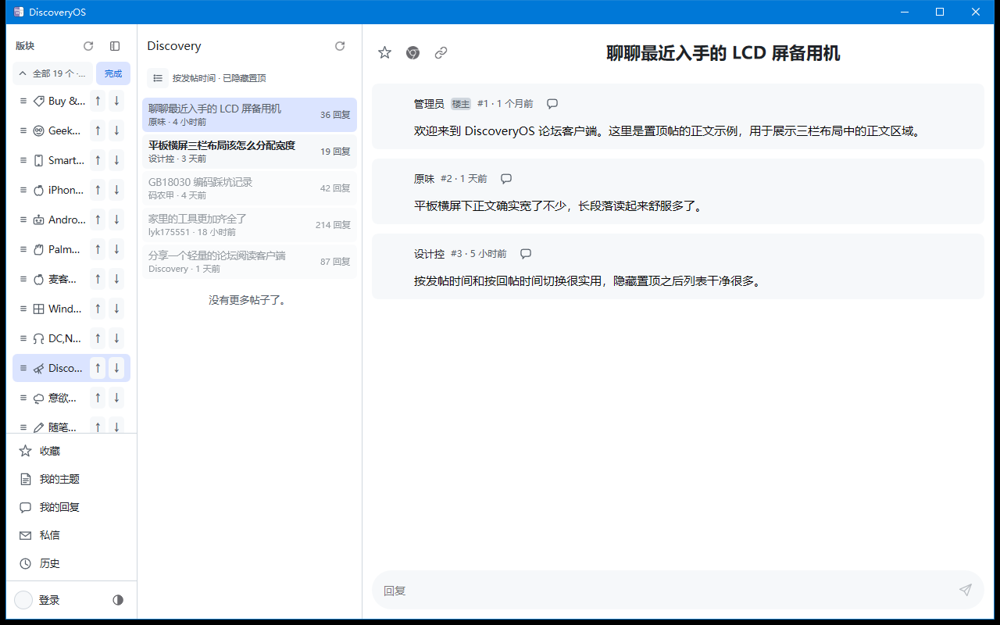

# DiscoveryOS · Android 平板客户端

一个为 **Android 平板**设计的 4d4y（Discovery）论坛原生客户端。全中文界面，三栏布局以正文阅读为中心：在不牺牲功能的前提下，尽量把屏幕留给内容。

> 本项目为**非官方**客户端，与 4d4y.com、Comsenz / Discuz! 无关联，也未获得其认可或赞助。论坛内容与账号数据归论坛及其用户所有，使用请遵守论坛规则。

---

## 界面预览

截图为 1280 × 800 平板横屏下的实际运行画面。

### 默认三栏视图


左侧版块与常用入口，中间帖子列表，右侧正文与回复；三个标题栏图标（收藏、浏览器打开、复制链接）等距排列，每个楼层右上角有引用按钮，底部常驻回帖输入框与「图片 / 附件」。

### 筛选控件展开


排序控件默认收起，点开显示「发帖时间 / 回帖时间」；长按任意帖子可「隐藏该贴」。已读帖子灰字显示，未读深色加粗。

### 版块折叠


默认只显示排序前 4 个版块，其余收在下方小图标堆里；点「展开全部 19 个」一次展开，「收起」回到 4 个，选择会被记住。

### 拖动排版



长按版块或点「排序」进入排版，按住上下拖动即可调整顺序；顺序会被记住。

---

## 本次更新（v1.0.25）

- **动画回调自然**：此前为流畅度把过渡削成了瞬跳，现恢复列表展开 / 置顶的 220ms 淡入淡出、头像与图片 160ms 淡入、图片查看器 200ms 入场。只恢复不触发重排的透明度合成层动画，并自动尊重系统「减少动态效果」。
- **APK 体积再降**：19.42 MB → 18.86 MB。`scripts/slim_apk.py` 新增 `--zopfli`，用最优 DEFLATE 重压 `libnsh.so` 并以手写 ZIP 条目嵌入，其余条目（尤其必须保持未压缩的 `resources.arsc`）原样保留。
- **运行内存更省**：帖子页缓存上限 200 → 48 页、正文 HTML 缓存 400 → 160 条，写入时主动清掉已过期的条目；删除无上限的死代码头像缓存，避免长时间浏览后内存持续累积。
- **验证**：真机启动、三栏、正文、头像淡入、图片查看器入场与 zopfli 压缩原生库加载均正常，无崩溃。

## 本次更新（v1.0.24）

- **图片保存改回右上角按钮**：查看器顶栏右侧恢复「保存」按钮，去掉长按保存（长按易误触发）。手机端点「保存」用系统浏览器打开原图（应用自身无法写公共目录，见下），提示「长按图片保存到相册，然后按返回键回到应用」。桌面端直接写入下载目录。
- **双指缩放（修复）**：查看器图片恢复双指缩放（1~4 倍），用 NSH 官方的 `Scroll` `zoomable` + `centerContent` 写法——图片按 `contain` 居中，双指捏合缩放、放大后可双向拖动。
- **文字选择改回正文原地选择（不弹面板）**：正文 `TextView` 直接 `selectable`，长按选词、拖动两端手柄调范围、系统「复制」。根因修复：Discuz 正文用 `<br>` 把整楼连成一个文本块，NSH 文本视图的长按命中只对**块内第一行**准确，按在后续行会落到段尾（于是「手柄拖不动、只能整行选」）。现把每个 `<br>` 拆成独立段落边界（`splitBrIntoParagraphs`，跳过 `<pre>/<code>` 代码块），每行成为独立文本块，命中落在正确的行；段落上下边距归零，视觉行距不变。
- **运行时升级**：NSH 0.5.0 → 0.5.1（补丁版，含移动端触摸与选择的修复）。
- **不再在选区期间改列表属性**：原实现在选中时把列表 `scrollable` 置 false、右滑返回摘掉，会在手势中途重排内容，让手指下的文字位移；现在列表保持可滚动（框架会在选择手势中自行停住滚动视图）。

> **关于「保存后自动跳回应用」**：Android 不允许一个应用监听另一个应用（浏览器）的操作，所以应用用浏览器打开原图后，**无法感知浏览器何时保存完成、也无法自动切回**——这是系统安全设计，不是本应用能突破的。已实测两条替代路都不通：① 应用内 WebView 长按图片，NSH 封装的 WebView 会拦截长按手势（日志 `input event not handled by webkit: GestureLongPress`），弹不出系统「保存图片」菜单；② 应用自身写公共目录（`fs` 在 Android 上完全不可用、无 MediaStore API）。因此保存仍走浏览器，提示文案已改为「长按图片保存到相册，然后按返回键回到应用」，一步返回即可继续使用。

## 本次更新（v1.0.23）

- **版块默认只显示 4 个**：按你排好的顺序取前 4 个，其余收在下方的小图标堆里；点「展开全部 19 个」一次展开，「收起」回到 4 个，选择会记住。
- **私信 / 我的主题 未读角标**：登录后约每 90 秒读取一次论坛未读数，在图标右上角显示红色数字小标 ——「私信」= 私人消息 + 公共消息，「我的主题」= 系统消息 + 好友消息 + 帖子消息；无未读或未登录时不显示。桌面预览 / 离线时静默不显示。
- **修复「第二天要重新登录」**：登录时向论坛请求 30 天持久登录（`cookietime`）。此前未发送，只拿到会话级 Cookie，隔天失效后只能重新登录。
- **修复个人区列表不显示头像**：根因是 `parseUser` 取头像时要求 `(UID:)` 出现在头像 `div` **之前**，而真实档案页顺序相反 → 按昵称取头像整条链路一直拿不到 URL。现改为**独立、顺序无关**地取 UID 与头像（已在真实档案页验证拿到 `…_avatar_middle.jpg`）。`私信` 另补上对方 uid；`收藏/我的主题` 按作者名取头像（缓存一天）；`我的回复` 页面本身不含作者信息，改为显示当前登录者自己的头像。
- **性能**：列表、帖子页、正文 HTML 均已缓存（列表按频道会话内缓存、帖子页缓存 10 分钟、正文按楼层缓存、列表虚拟化）；**正文下一页后台预取**，滚动加载更顺；头像昵称查询限制为最多 3 个并发。正文图片本身已是论坛的压缩显示版（实测约 88 KB/张）、按可见楼层懒加载，且论坛没有更小的缩略图接口可用，故单图速度主要受 NSH 文本视图的图片加载器限制。
- **竖屏版块数字被裁**：窄栏（56dp）里的新版块数徽标原来从图标右侧 16dp 起、最宽 30dp，会溢出被裁；现字号 9、左移到 6dp、宽度 ≤22dp，竖屏完整显示，横屏不变。
- **正文图片查看**：点正文图片弹出全屏查看器（右上「关闭 / 保存」，双指可放大）。图片按自身比例缩放到屏幕内**完整居中显示**（此前用屏幕比例的框去装，`objectFit` 又写成了 prop，等于 `cover`，所以只看到局部被裁）；查看器画的是页面里的压缩显示版，过大原图在 Android 上解码会失败。**「保存」用系统浏览器打开原图**，在浏览器里长按即可存进相册/下载目录：Android 上 NSH 的 `fs` 根本不做文件读写（调用直接返回 `ERR_FEATURE_UNAVAILABLE_ON_PLATFORM`，手机端数据只走 `Storage`），`nsh.json` 的写权限根目录也扩不到公共下载目录（实测把 `/storage/emulated/0/Download` 加进 `fs.write` 仍失败，且清单里只有 `INTERNET`/`POST_NOTIFICATIONS`，没有也不可添加存储权限），所以应用自身无法直接落盘到下载文件夹。
- **选区配色**：选中文字的底纹与两端手柄原来跟随系统强调色（白色手柄在白底上看不见）。现改为统一蓝色（`selection:bg-blue-500`），明暗两种主题下都能看清；`selectionColor` 只能通过 class 生效，写在 `styles` 里会被忽略。
- **文字可选可复制**：正文 `TextView` 打开 `selectable`，长按选中、系统复制。选区存在期间会**停用列表滚动与右滑返回**——这两个手势会抢走手柄的拖动，导致手柄拖不动、只能整行选。
- **正文下拉刷新**：回复列表滚到顶部下拉即刷新本贴。

## 设计思路

为平板而做，核心只有一句：**把屏幕留给正文**。

- **正文优先的三栏**：版块栏 168dp、帖子列表 288dp、正文占其余，1200dp 横屏下正文约占 62% 屏宽；版块与帖子行 36dp、图标按钮 32dp，一屏容纳更多。
- **顺手**：常用入口固定在侧栏不随滚动消失；系统返回键按层级退出；下拉刷新、正文右滑返回；无 hover / 快捷键依赖。
- **好读**：已读置灰、未读加粗；正文图片点击放大并可保存；引用块可跳转楼层；B 站 / 抖音 / 小红书及常见视频链接内嵌播放。
- **够轻、够安全**：只申请 `INTERNET` 一项权限；不存明文密码、仅保持会话 Cookie；数据全部在应用私有存储中。

功能面同样齐全：19 个真实版块、长按拖动排序、发帖 / 回帖两种排序、回帖与发帖可加图片附件、收藏 / 我的主题 / 我的回复 / 私信 / 历史常驻侧栏。

---

## 体积与资源占用

| 项目 | 数值 |
| --- | --- |
| 当前版本 | 1.0.25（versionCode 27） |
| APK 体积 | 约 18.9 MB（单 arm64-v8a） |
| 应用自身逻辑包 | 约 245 KB（`assets/nsh/bundle.nshc`） |
| 应用图标 | 约 13 KB |
| 主要体积来源 | NSH 预编译运行时 `lib/arm64-v8a/libnsh.so`（原始 46.6 MB，压缩存储后约 19 MB） |
| 安装后设备占用 | 约 66 MB（系统在安装时解压原生库；下载包小、设备多占一份） |
| 运行权限 | 仅 `android.permission.INTERNET` |
| 系统要求 | minSdk 26 / targetSdk 35，面向 Android 10 及以上平板 |
| 本地数据 | 浏览历史上限 200 条；版块顺序、排序与筛选、会话 Cookie 存于应用私有存储 |
| 账户信息 | 不落盘明文密码，仅保持 Cookie |

> 应用自身代码与资源不到 300 KB，体积几乎全部来自框架运行时。原生库以压缩方式存储、安装时由系统解压，因此下载体积明显减小，但设备占用相应增加，运行内存不变。

---

## 安装

1. 从 [Releases](https://github.com/zhang8686/DiscoveryOS-Tablet/releases) 下载最新版 `DiscoveryOS-AndroidPad-V1.0.25.apk`。
2. 在 Android 平板上打开该文件；首次安装时系统可能要求为安装来源开启「允许安装未知应用」，授权一次即可。
3. 仅支持 **arm64-v8a** 设备，32 位平板不在支持范围。
4. 论坛内容需要登录后查看，请在应用内登录 4d4y 账号。

升级时请使用同一签名密钥发布的版本，否则无法覆盖安装。

---

## 源码与构建

本仓库为纯 TSX 工程，使用 NSH 打包；发布包额外做一次原生库压缩以减小下载体积：

```bash
nsh package App.tsx --target android --icon icon.png --abi arm64-v8a \
  --keystore <release.jks> --key-alias <alias>
python scripts/slim_apk.py .nsh/out/DiscoveryOS.apk unsigned.apk --zopfli
zipalign -f -p 4 unsigned.apk aligned.apk
apksigner sign --ks <release.jks> --ks-key-alias <alias> \
  --out DiscoveryOS-AndroidPad-V1.0.25.apk aligned.apk
```

`scripts/slim_apk.py` 把清单中的 `android:extractNativeLibs` 设为 `true`，把 `lib/<abi>/*.so` 改为压缩存储；加 `--zopfli` 时再用最优 DEFLATE 重压该原生库（约省 0.55 MB）。其余条目逐字节保留，应用代码与资源不受影响。重打包后必须用同一 release keystore 重新签名。

构建环境：NSH 0.5.1、JDK 17、Android SDK 35 / build-tools 35.0.1。发布包使用自己的 release keystore 签名（密钥不随仓库分发）。

主要目录：

| 路径 | 内容 |
| --- | --- |
| `App.tsx` | 应用入口、登录与整体状态 |
| `src/discuz/` | 论坛请求、GB18030 编解码、页面解析、Cookie 与收藏 |
| `src/ui/` | 三栏界面、简笔画图标、帖子行、回复框、播放器组件 |
| `src/bilibili`、`src/douyin` 等 | 外链媒体的解析与播放 |
| `screenshots/` | 本文所用界面截图 |
| `scripts/slim_apk.py` | 发布包原生库压缩与重打包 |

---

## 源码来源与致谢

- **[nicoster/DiscoveryOS-nsh](https://github.com/nicoster/DiscoveryOS-nsh)** — 上游项目，由 **Nick Xiao** 开发的 4d4y 论坛桌面客户端（MIT 许可）。本应用在其论坛数据层与界面结构之上构建，谨致谢意。
- **[NSH / Native Shell](https://nsh.dev)**（[longbridge/nsh](https://github.com/longbridge/nsh)，Apache-2.0）— 让同一套 TSX 代码运行于桌面与 Android 的原生 UI 框架。
- **4d4y.com（Discovery 论坛）** 与社区用户 — 论坛内容与讨论的提供者。
- **Simple Icons（CC0）** — 原仓部分 SVG 图标来源；本应用版块与功能项的线稿图标为项目自绘。

感谢上游作者与维护者开放源码，也感谢论坛社区长期积累的内容。

---

## 许可与免责

本仓库沿用上游的 **MIT License**，版权声明见 [LICENSE](LICENSE)。

本软件按「现状」提供，不附带任何明示或默示担保；作者不对使用本软件产生的任何主张、损害或责任负责。本项目为非官方客户端，与 4d4y.com、Comsenz / Discuz! 无任何隶属、认可或赞助关系。
