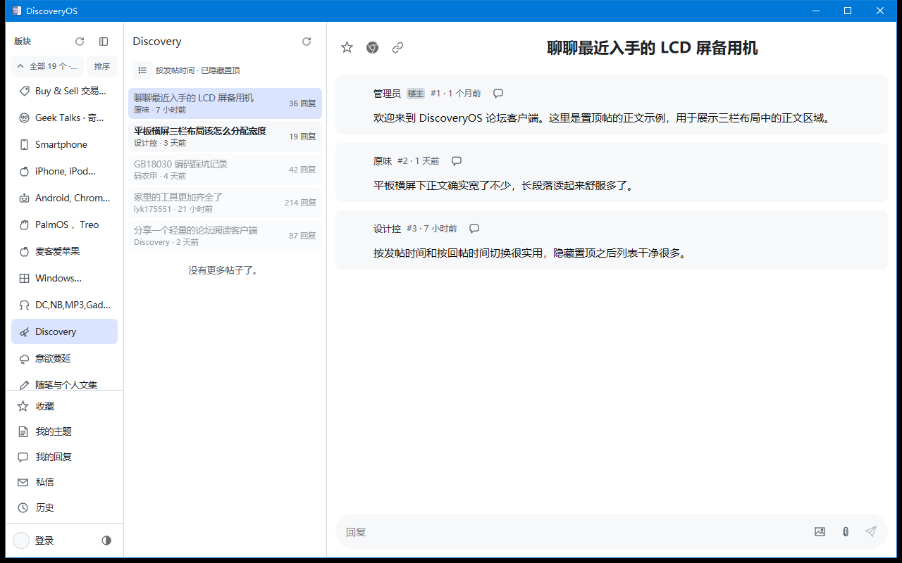
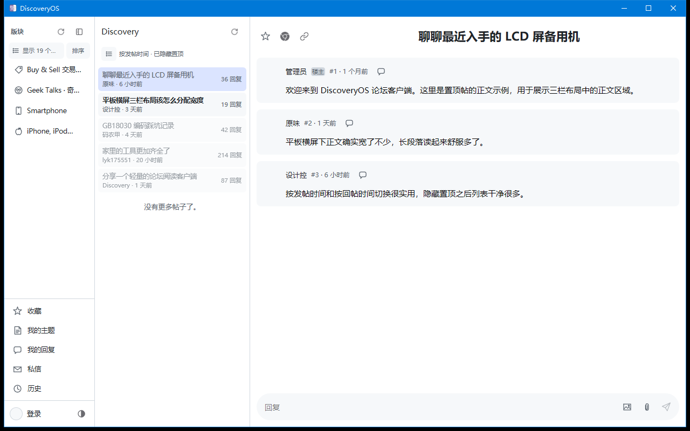

# DiscoveryOSX · 4d4y 论坛客户端（手机 / 平板通用）

一个为 4d4y（Discovery）论坛设计的 Android 客户端，用 TypeScript / TSX 与 nsh 运行时自绘界面，全中文。

> **同一个安装包，手机和平板都能装、都能用。**
> 不需要分辨机型下载不同版本：应用按窗口宽度自动在**单栏（手机竖屏）/ 双栏（手机横屏、小平板）/ 三栏（大平板）**之间切换，界面元素随屏幕伸缩，横竖屏旋转即时重排。Android 8.0 及以上的 arm64 手机、平板均可安装。

> 本项目为**非官方**客户端，与 4d4y.com、Comsenz / Discuz! 无关联，也未获得其认可或赞助。论坛内容与账号数据归论坛及其用户所有，使用请遵守论坛规则。
>
> **最新版本 v1.2.2-4**（2026-11-26）：应用内检查更新 + 清除缓存 + 搜索翻页。菜单新增「检查更新」，有新版本时版本号旁亮红点，弹窗可选「是」（打开下载页覆盖安装）或「忽略」；设置里新增「清除缓存」并显示缓存体积；搜索结果可以一页页翻到底。视频附件改由浏览器播放、音频下载后分享；同一张图的多个地址合并，查看原图后左右滑动不再要滑两次；回复卡首帧按实际宽度排版，正文不再向右溢出；正文图片预热只做新到的一页，加载更快。详见 [更新记录](CHANGELOG.md)；安装包见 [Releases](https://github.com/zhang8686/DiscoveryOS-Android/releases)。

---

## 兼容性一览

| 项目 | 支持情况 |
| --- | --- |
| 设备类型 | **手机、平板通用**（含折叠屏、横竖屏切换） |
| 系统版本 | Android 8.0（API 26）及以上，含 Android 15/16 等新系统 |
| CPU 架构 | arm64-v8a（64 位 ARM，覆盖近十年的主流机型） |
| 屏幕 | 小屏、普通、大屏、超大屏均声明支持，无固定方向 |
| 16 KB 页设备 | 已按 16 KB 页对齐，Android 15 起采用 16 KB 页大小的新机型可直接运行 |
| 权限 | 仅 `INTERNET`、`ACCESS_NETWORK_STATE`（均为普通权限，安装无提示） |

---

## 界面预览

> 以下为三栏布局的界面示意（首版拍摄）：v1.1.0 在此基础上收紧了楼层间距、去掉了内嵌视频播放器，并新增「温暖米色」暖色主题；手机端使用单栏 / 双栏布局。

### 默认三栏视图



左侧版块与常用入口，中间帖子列表，右侧正文与回复；三个标题栏图标（收藏、浏览器打开、复制链接）等距排列，每个楼层右上角有引用按钮，底部常驻回帖输入框与「图片 / 附件」。

### 筛选控件展开


### 版块折叠



### 拖动排版


---

## 功能

- **版块与列表**：版块栏可折叠、可拖动排序；帖子列表分页加载不跳回首页，支持下拉刷新（不足一屏的列表同样可刷），滚动中到达的新数据等手势停下再插入，惯性滑动不被打断；搜索结果同样可以一页页往下翻。
- **外观主题**：跟随系统 / 浅色 / 深色之外，新增**「温暖米色」暖色主题**——米色纸张底、浅一档的卡片、棕黑文字，长时间阅读更柔和；四种模式随时切换，即时生效。
- **正文阅读**：楼层间距紧凑；正文图片按屏幕像素宽度请求，全宽显示不发虚；点击进入可缩放的图片查看器。
- **链接**：正文中的网址——包括手打的裸网址——都可以直接点开；站内帖子链接在应用内跳转，站外交给浏览器或对应 App。
- **图片工具**：查看器支持双指缩放、左右切换、保存，以及**扫描图片中的二维码**。
- **账号**：登录状态持久化；头像按 uid 直连论坛 CDN，并按作者逐行渲染；账户资料卡显示当前版本号，菜单里的「检查更新」可当场查新版本并打开下载页。
- **检查更新**：启动后静默查一次（一周内不重复），有新版本时版本号旁亮红点；「是」打开下载页覆盖安装（登录状态不变），「忽略」这一版不再提示。设置里还有「清除缓存」，显示图片缓存体积并可一键清理。
- **提醒**：未读提醒在头像上显示红点；进入提醒列表即标记为已读（与网页同步），切回前台立即刷新计数。
- **发帖 / 回帖**：支持引用、图片与附件上传，正文尾部自动附加签名。
- **外链媒体**：不内嵌第三方播放器，B 站 / 抖音等链接交给系统处理，应用更轻、播放更稳。
- **稳定性**：所有请求都有超时保护（页面 30 秒、附件 90 秒、上传 180 秒），页面与图片请求失败自动重试一次。

---

## 设计思路

核心只有一句：**把屏幕留给正文**。

- **正文优先的布局**：手机竖屏单栏、手机横屏与小尺寸平板双栏、大平板三栏；版块栏 168dp、帖子列表 288dp、正文占其余，1200dp 横屏下正文约占 62% 屏宽。版块与帖子行 36dp、图标按钮 32dp，一屏容纳更多。
- **一套代码两种设备**：不区分手机版与平板版，避免两份包各自维护、版本不同步；布局只随窗口宽度变化。
- **顺手**：常用入口固定在侧栏不随滚动消失；系统返回键按层级退出；下拉刷新、正文右滑返回。
- **好读**：已读置灰、未读加粗；正文图片点击放大并可保存；引用块可跳转楼层。
- **够轻、够安全**：只申请 `INTERNET`（联网）与 `ACCESS_NETWORK_STATE`（网络状态）两项普通权限，安装时不弹授权；不存明文密码、仅保持会话 Cookie；数据全部在应用私有存储中。

功能面同样齐全：19 个真实版块、长按拖动排序、发帖 / 回帖两种排序、回帖与发帖可加图片附件、收藏 / 我的主题 / 我的回复 / 私信 / 历史常驻侧栏。

---

## 体积与资源占用

| 项目 | 数值 |
| --- | --- |
| 当前版本 | 1.2.2-4（versionCode 92） |
| APK 体积 | 约 19.6 MB（19,588,826 B，单 arm64-v8a，手机与平板共用） |
| 应用自身逻辑包 | 约 510 KB（`assets/nsh/bundle.nshc`，含二维码解码器） |
| 应用图标 | 约 13 KB |
| 主要体积来源 | NSH 运行时 `lib/arm64-v8a/libnsh.so`（原始 42.1 MB，Zopfli 压缩后约 19.1 MB） |
| 运行内存 | 实测 PSS 约 200 MB，其中 JS 逻辑与缓存约 10 MB，其余为运行时与图片解码 |
| 运行权限 | 仅 `android.permission.INTERNET`、`android.permission.ACCESS_NETWORK_STATE`（均为普通权限，安装无提示） |
| 系统要求 | minSdk 26（Android 8.0）/ targetSdk 35 |
| 本地数据 | 浏览历史上限 200 条；版块顺序、排序与筛选、会话 Cookie 存于应用私有存储 |
| 账户信息 | 不落盘明文密码，仅保持 Cookie |

> 应用自身代码与资源不到 500 KB，体积几乎全部来自框架运行时。原生库以压缩方式存储、安装时由系统解压，因此下载体积明显减小，但设备占用相应增加。

---

## 安装

1. 从 [Releases](https://github.com/zhang8686/DiscoveryOS-Android/releases) 下载最新版 `DiscoveryOSX-V1.2.2-4-release.apk`。**手机和平板下载同一个文件**。
2. 在设备上打开该文件；首次安装时系统可能要求为安装来源开启「允许安装未知应用」，授权一次即可。
3. 系统需为 Android 8.0 及以上，CPU 为 arm64-v8a；32 位设备不在支持范围。
4. 论坛内容需要登录后查看，请在应用内登录 4d4y 账号。

> **关于包名**：本版包名为 `com.Android.DiscoveryOSX`，与旧版 `com.Android.DiscoveryOS` 是两个独立应用，可以并存；卸载旧版不影响新版。首次安装后需要重新登录一次。
>
> **v1.1.6 起使用新的发布证书**（SHA-256 `7155e75f…2b07`），已安装 v1.1.0 的设备请先卸载旧版再安装；此后版本沿用同一证书即可覆盖升级。

---

## 源码与构建

需要 nsh 工具链与 Android SDK（build-tools 35 以上，`zipalign -P` 用于 16 KB 页对齐）。

```bash
# 1. 打包（产物在 .nsh/out/DiscoveryOSX.apk）
nsh package App.tsx --target android --abi arm64-v8a

# 2. 压缩原生库并修补 manifest（extractNativeLibs、windowSoftInputMode）
python scripts/slim_apk.py .nsh/out/DiscoveryOSX.apk build/unsigned.apk --zopfli 5

# 3. 16 KB 页对齐（Android 15 起的 16 KB 页设备要求，-P 与 -p 不能同时使用）
zipalign -P 16 -f 4 build/unsigned.apk build/aligned.apk

# 4. 签名（v2 + v3）
apksigner sign --ks keystore/discoveryos-release.jks --ks-key-alias discoveryos \
  --v2-signing-enabled true --v3-signing-enabled true \
  --out DiscoveryOSX-V1.2.2-release.apk build/aligned.apk
```

检查：

```bash
nsh check                                  # 类型检查
nsh test                                   # 单元与界面测试
apksigner verify -v DiscoveryOSX-V1.2.2-release.apk
zipalign -c -P 16 4 DiscoveryOSX-V1.2.2-release.apk
```

> 若改过 `nsh.json` 的 `name`，产物文件名会随名称变化；打包前先清理 `.nsh/out/`，避免签到上一次的旧包。
>
> 发布证书不在仓库内，请自行备份 `keystore/discoveryos-release.jks`（别名 `discoveryos`）；后续版本必须用同一证书签名。

---

## 目录结构

```
App.tsx              应用外壳：登录、账户资料卡、主题、更新检查、全局浮层
App.test.tsx         外壳的界面测试
session.test.ts      登录状态恢复的回归测试
nsh.json             应用清单：名称、包名、版本、网络与能力声明
tsconfig.json        TypeScript 配置
scripts/
  slim_apk.py        打包后处理：原生库压缩（Zopfli）、manifest 修补
src/
  discuz/            论坛协议层：请求、GB18030 编解码、HTML 解析、会话与登录、
                     帖子/回复/提醒/私信、附件、收藏、历史、草稿
  net/               请求日志与流量记录
  ui/                界面层：三栏布局、帖子列表、正文与楼层、回帖框、图片查看器、
                     二维码扫描、设置与外观、图标、键盘与快捷键
screenshots/         界面截图
docs/                历史版本的更新说明
```

---

## 源码来源与致谢

- **[nicoster/DiscoveryOS-nsh](https://github.com/nicoster/DiscoveryOS-nsh)** — 上游项目，由 **Nick Xiao** 开发的 4d4y 论坛桌面客户端（MIT 许可）。本应用在其论坛数据层与界面结构之上构建，谨致谢意。
- **[NSH / Native Shell](https://nsh.dev)**（[longbridge/nsh](https://github.com/longbridge/nsh)，Apache-2.0）— 让同一套 TSX 代码运行于桌面与 Android 的原生 UI 框架。
- **[jsQR](https://github.com/cozmo/jsQR)**（Apache-2.0）— 图片二维码识别。
- **4d4y.com（Discovery 论坛）** 与社区用户 — 论坛内容与讨论的提供者。
- **Simple Icons（CC0）** — 原仓部分 SVG 图标来源；本应用版块与功能项的线稿图标为项目自绘。

感谢上游作者与维护者开放源码，也感谢论坛社区长期积累的内容。

---

## 许可与免责

本仓库沿用上游的 **MIT License**，版权声明见 [LICENSE](LICENSE)。

本软件按「现状」提供，不附带任何明示或默示担保；作者不对使用本软件产生的任何主张、损害或责任负责。本项目为非官方客户端，与 4d4y.com、Comsenz / Discuz! 无任何隶属、认可或赞助关系。
