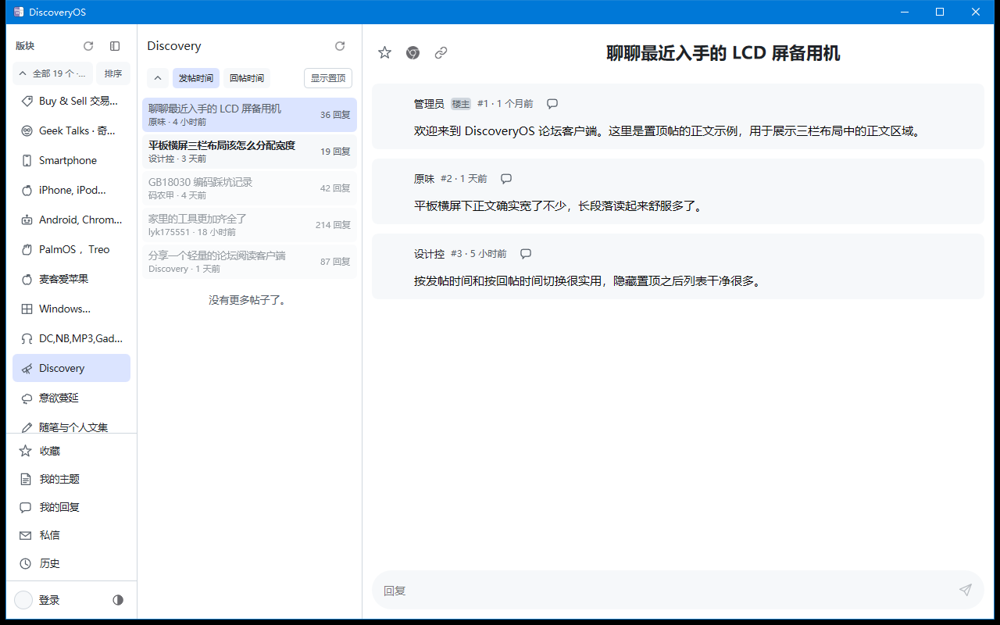

# DiscoveryOS · Android 平板客户端

一个为 **Android 平板**设计的 4d4y（Discovery）论坛原生客户端。全中文界面，三栏布局以正文阅读为中心，在不牺牲功能的前提下尽量把屏幕留给内容。

> 本项目为**非官方**客户端，与 4d4y.com、Comsenz / Discuz! 无关联，也未获得其认可或赞助。论坛内容与账号数据归论坛及其用户所有，使用请遵守论坛规则。

---

## 界面预览

截图为 1280 × 800 平板横屏下的实际运行画面。

### 默认三栏视图


左侧为版块与常用入口，中间是帖子列表，右侧为正文与回复区；三个标题栏图标（收藏、浏览器打开、复制链接）等距排列，每个楼层右上角提供引用按钮，底部始终保留回帖输入框。

### 筛选控件展开



不常用的排序与置顶控件默认收起，点开后才显示小巧的「发帖时间 / 回帖时间 / 隐藏置顶」按钮。列表里已读帖子以灰字显示，未读帖子深色加粗。

### 版块折叠


全部 19 个版块默认展开，也可一键收起，只留有更新的版块。

### 拖动排版


长按版块或点「排序」进入排版模式，按住上下拖动即可调整顺序，把常逛的版块排到最前；顺序会被记住。

---

## 特色亮点

### 为平板而生的三栏
- **正文优先**：版块栏 168dp、帖子列表 288dp、正文占剩余空间，1200dp 横屏下正文约占 62% 屏宽。
- **紧凑但不拥挤**：版块与帖子行 36dp、版块名单行省略、图标按钮 32dp，一屏能看到更多内容。
- **触摸优先**：无 hover / 快捷键依赖，系统返回键按层级退出，常用入口固定在侧栏底部不随滚动消失。
- 全中文界面，含相对时间、提示与错误信息；带启动器图标。

### 版块与浏览
- 内置论坛**全部 19 个真实版块**，默认全展开，可一键收起为「只看有更新」。
- **按内容绘制的简笔画线稿图标**：交易价签、望远镜、铅笔、手机、苹果、机器人、耳机、碗筷等，风格统一。
- **长按拖动版块排序**，另有上移 / 下移微调，把喜欢的版块排到前面；顺序跨启动保留。
- **两种排序**：按发帖时间或按回帖时间；**置顶帖**可自由屏蔽或显示。
- **已读置灰**：打开过的帖子变灰变淡，未读深色加粗，一眼分辨。
- 折叠式筛选条：不常用的控件默认收起，界面更简洁。

### 阅读与互动
- 「收藏 / 我的主题 / 我的回复 / 私信 / 历史」常驻侧栏，登录后即可使用。
- 正文标题旁的**收藏星标**、每个楼层的**引用回复**、底部**回帖输入框**始终可见；引用块可跳转到对应楼层。
- 保留 B 站、抖音、小红书及常见视频链接的内嵌播放能力。
- 版块顺序、排序方式、置顶开关、浏览历史等本地状态自动保存。

### 轻快与隐私
- 单 ABI（arm64-v8a）release 包，去掉桌面标题栏、菜单、快捷键、自动更新与系统密钥链。
- **不保存明文密码**，仅保持会话 Cookie。
- 只申请 `INTERNET` 一项权限；本地数据全部放在应用私有存储中。

---

## 体积与资源占用

| 项目 | 数值 |
| --- | --- |
| APK 体积 | 约 47 MB（单 arm64-v8a，release 签名） |
| 应用自身逻辑包 | 约 232 KB（`assets/nsh/bundle.nshc`） |
| 应用图标 | 约 13 KB |
| 主要体积来源 | NSH 预编译运行时 `lib/arm64-v8a/libnsh.so`（约 48.9 MB，未压缩） |
| 运行权限 | 仅 `android.permission.INTERNET` |
| 系统要求 | minSdk 26 / targetSdk 35，面向 Android 10 及以上平板 |
| 本地数据 | 浏览历史上限 200 条；版块顺序、排序与筛选开关、会话 Cookie 存于应用私有存储 |
| 账户信息 | 不落盘明文密码，仅保持 Cookie |

> 47 MB 主要是框架运行时固有体积，应用自身代码与资源不到 300 KB。

---

## 安装

1. 下载 Releases 中的 `DiscoveryOS.apk`（release 签名，可直接安装，用户无需持有签名密钥）。
2. 在 Android 平板上打开该文件；首次安装时系统可能要求为安装来源开启「允许安装未知应用」，授权一次即可。
3. 应用支持 **arm64-v8a** 设备；32 位平板不在支持范围。
4. 论坛内容需要登录后查看，请在应用内登录 4d4y 账号。

升级时请使用同一签名密钥发布的版本，否则无法覆盖安装。

---

## 源码与构建

本仓库为纯 TSX 工程，使用 NSH 打包：

```bash
nsh package App.tsx --target android --icon icon.png --abi arm64-v8a
```

构建环境：NSH 0.5.0、JDK 17、Android SDK 35 / build-tools 35.0.1。发布包使用自己的 release keystore 签名（密钥不随仓库分发）。

主要目录：

| 路径 | 内容 |
| --- | --- |
| `App.tsx` | 应用入口、登录与整体状态 |
| `src/discuz/` | 论坛请求、GB18030 编解码、页面解析、Cookie 与收藏 |
| `src/ui/` | 三栏界面、简笔画图标、帖子行、回复框、播放器组件 |
| `src/bilibili`、`src/douyin` 等 | 外链媒体的解析与播放 |
| `screenshots/` | 本文所用界面截图 |

---

## 源码来源与致谢

- **[nicoster/DiscoveryOS-nsh](https://github.com/nicoster/DiscoveryOS-nsh)** — 上游项目，由 **Nick Xiao** 开发的 4d4y 论坛桌面客户端（MIT 许可）。本应用在其论坛数据层与界面结构之上构建，谨致谢意。
- **[NSH / Native Shell](https://nsh.dev)**（[longbridge/nsh](https://github.com/longbridge/nsh)，Apache-2.0）— 让同一套 TSX 代码运行于桌面与 Android 的原生 UI 框架。
- **4d4y.com（Discovery 论坛）** 与社区用户 — 论坛内容与讨论的提供者。
- **Simple Icons（CC0）** — 原仓部分 SVG 图标来源；本应用版块与功能项的线稿图标为项目自绘。

感谢上游作者与维护者开放源码，也感谢论坛社区长期积累的内容。

---

## 许可与免责

本仓库沿用上游的 **MIT License**，版权声明见 [LICENSE](LICENSE)。

本软件按「现状」提供，不附带任何明示或默示担保；作者不对使用本软件产生的任何主张、损害或责任负责。本项目为非官方客户端，与 4d4y.com、Comsenz / Discuz! 无任何隶属、认可或赞助关系。
